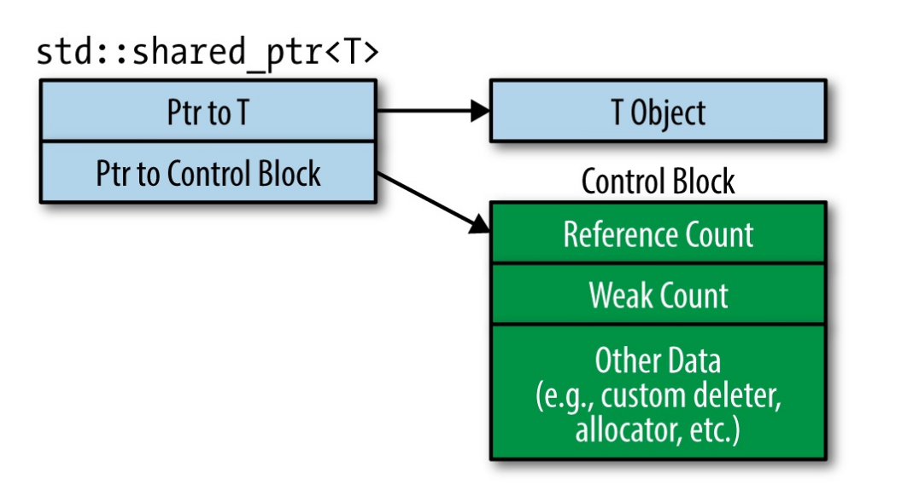

Smart pointers in C++ are RAII-based objects that automatically manage the lifetime of dynamically allocated objects.

# Types of Smart pointers
1. unique_ptr
2. shared_ptr
3. weak_ptr

## unique_ptr
1. Stores only one pointer at a time.
2. Cannot be copied.
3. Ownership can be transferred using `std::move`
4. `unique_ptr` are always passed as reference to functions. Because copy constructor is deleted in `unique_ptr`

#### Example

```c++

class cA
{
private:
    int m_i;

public:
    cA(int x = -1) : m_i(x)
    {
        cout << "cA::Cons\n";
    }
    ~cA()
    {
        cout << "~cA::Des\n";
    }
    void display() const
    {
        cout << "cA::display: this = " << this << ", m_i = " << m_i << "\n";
    }
};

int main()
{
    cA *ap = new cA();
    // Creating a unique ptr for raw ptr ap
    unique_ptr<cA> up1(ap);
    cout << "up1 = " << up1.get() << "\n";
    
    // Other way of creating unique_ptr
    unique_ptr<cA> up2(new cA());

    // Moving the ownership of the ap ptr
    unique_ptr<cA> up3(std::move(up1));
    cout << "up1 = " << up1.get() << "\n"; // will get nullptr
    cout << "up2 = " << up2.get() << "\n";
    cout << "up3 = " << up3.get() << "\n";

    //up1->display(); // ERROR: nullptr
    up2->display();
    up3->display();
}

```

```sh
cA::Cons
up1 = 0x5eb3789aa920
cA::Cons
up1 = 0 // nullptr, no resource
up2 = 0x5eb3789aad50
up3 = 0x5eb3789aa920 // Same address as up1, because of std::move
cA::display: this = 0x5eb3789aad50, m_i = -1
cA::display: this = 0x5eb3789aa920, m_i = -1
~cA::Des
~cA::Des
```

#### Example2 

```c++
int main()
{
    vector<unique_ptr<cA>> objs;
    objs.push_back(unique_ptr<cA>(new cA(1)));
    objs.push_back(unique_ptr<cA>(new cA()));
    objs.push_back(unique_ptr<cA>(new cA()));
    objs.push_back(unique_ptr<cA>(new cA()));

    // unique_ptr is passed by reference, if we pass by value instead, then compiler will throw error because unique_ptr copy constructor is deleted.
    for (const auto &obj : objs)
    {
        obj->display();
    }
}
```

#### Initialize raw array of unique_ptr

```c++
#include <iostream>
#include <memory>

int main()
{
    // Raw array of unique_ptr
    std::unique_ptr<int[]> up_arr(nullptr);

    up_arr.reset(new int[5]{1, 2, 3, 4, 5});

    for(int i = 0; i < 5; i++)
    {
        std::cout << up_arr[i] << std::endl;
    }
}
```

### Custom deleter in unique_ptr

Let's below classes as example. 

```c++
#include <iostream>
#include <memory>

class Investment{
public:
    Investment(int principal) : m_principal{principal}
    {
    }
    virtual ~Investment()
    {
        std::cout << "~Investment() called..." << std::endl;
    }
protected:
    int m_principal{};
};

class Stock: public Investment
{
public:
    Stock(int numOfStocks, int principal) : Investment(principal),  m_numOfStocks{numOfStocks}
    {
    }
    ~Stock()
    {
        std::cout << "~Stock() called..." << std::endl;
    }
private:
    int m_numOfStocks{};
};

class Bond: public Investment {
public:
    Bond(int numOfBonds, int principal) : Investment(principal),  m_numOfBonds{numOfBonds}
    {
    }
    ~Bond()
    {
        std::cout << "~Bond() called..." << std::endl;
    }
private:
    int m_numOfBonds{};
};

template <typename... Ts>
std::unique_ptr<Investment>
makeInvestment(int objType, Ts&&... params)
{
    std::unique_ptr<Investment> pInv(nullptr);

    if(objType == 1)
    {
        pInv.reset(new Bond(std::forward<Ts>(params)...));
    }
    else if(objType == 2)
    {
        pInv.reset(new Stock(std::forward<Ts>(params)...));
    }

    return pInv;
}

int main()
{
    auto aInvs = makeInvestment(1, 10, 10000);

    auto bInvs = makeInvestment(2, 100, 10000);
}

```

The makeInvestment creates a `Investment` object based on the object that needs to be created, like `Stock` or `Bond`.

Let's say we want to a custom deleter function when `std::unique_ptr` goes out of scope.

We can achive this by having deleter functions in two ways
1. Lambda functions
2. function pointers

#### Lambda functions

```c++
//... other code

auto delInv = [](Investment * investment) // The function takes Raw pointer as i/p
{
    std::cout << "Deleting Investment obj" << std::endl;
    delete investment;
};

template <typename... Ts>
std::unique_ptr<Investment, decltype(delInv)>
makeInvestment(int objTpye, Ts&&... params)
{
    // This declaration is essential
    // Without this unique_ptr will take default delete function
    std::unique_ptr<Investment, decltype(delInv)> pInv(nullptr, delInv);

    // ... rest of the code
}

int main()
{
    auto aInvs = makeInvestment(1, 10, 10000);
    std::cout << "sizeof(pInvestment) :: " << sizeof(pInvestment) << std::endl;
}
```

##### O/p

```sh
sizeof(pInvestment) :: 8
Deleting investment obj
~Stock() called...
~Investment() called...
```

#### Function pointer

```c++
//... other code
void delInvmt2(Investment * pInvestment)
{
    std::cout << "Deleting investment obj" << std::endl;
    delete pInvestment;
};

template <typename... Ts>
std::unique_ptr<Investment, void (*)(Investment *)> 
// return type has size of Investment* plus atleast size of function pointer!
makeInvestment(int objType, Ts&&... params)
{
    std::unique_ptr<Investment, void (*)(Investment *)> pInv(nullptr, delInvmt2);

    // ... rest of the code
}

int main()
{
    auto aInvs = makeInvestment(1, 10, 10000);
    std::cout << "sizeof(pInvestment) :: " << sizeof(pInvestment) << std::endl;
}
```

##### O/p

```sh
sizeof(pInvestment) :: 16 # unique_ptr size has increased
Deleting investment obj
~Stock() called...
~Investment() called...
```

- When using function pointer, the size of unique_ptr has increased because of size of function pointer.

- Prefer lamda delete function over function pointers.

#### C++ 14 version

```c++ 
template <typename... Ts>
auto makeInvestment(int objType, Ts&&... params)
{
    // Lambda function is inside factory function
    auto delInv = [](Investment * pInvestment) 
    {
        std::cout << "Deleting Investment obj" << std::endl;
        delete pInvestment;
    };

    std::unique_ptr<Investment, decltype(delInv)> pInv(nullptr, delInv);

    if(objType == 1)
    {
        pInv.reset(new Bond(std::forward<Ts>(params)...));
    }
    else if(objType == 2)
    {
        pInv.reset(new Stock(std::forward<Ts>(params)...));
    }

    return pInv;
}


int main()
{
    auto pInvestment = makeInvestment(2, 10, 10000);

    std::cout << "sizeof(pInvestment) :: " << sizeof(pInvestment) << std::endl;
}
```

## shared_ptr
- Allows multiple pointers to share the ownership of the same object.
- Reference counting is used to manage ownership
- `shared_ptr` expects objects/resources created in heap. It takes the ownership of the object.
- The object gets destroyed when reference count reaches `0`
- `make_shared` is used to create a `shared_ptr` for a specified type after creating it dynamically in heap memory

- `shared_ptr` are twice the size of raw pointer because it
    1. Has a pointer to the resource
    2. Has a pointer to the resource reference count

- The resource reference count is stored dynamically. This can be resolved by using `std::make_shared`.
- The size of a `std::shared_ptr` will be typically the size of two raw pointers. On a 64-bit archi, **16 bytes**.

### Move vs Copy

- Move-constructing a `std:shared_ptr` to another `std:shared_ptr` sets the source `std:shared_ptr` to null.
- Copy-constructing will increment the reference count. 
- Move-construction is faster than Copy-construction.
- Move assignment is faster than Copy assignment.


### Custom deleter 

```cpp

auto logDel = [](Widget * pw)
                {
                    std::cout << "Deleting object Widget" << std::endl;
                    delete pw;
                    pw = nullptr;
                };

// Deleter is part of ptr type
std::unique_ptr<Widget, decltype(logDel)> upw (new Widget, logDel); 

// Deleter is not part of ptr type
std::shared_ptr<Widget> spw(new Widget, logDel);
```

Let's see below example where we have two different types of custom deleters
1. Lambda
2. Function pointers

```cpp
auto logDel = [](Widget * pw)
                {
                    std::cout << "Deleting object Widget" << std::endl;
                    delete pw;
                };

void logDelFn(Widget * pw)
{
    std::cout << "Deleting object Widget" << std::endl;
    delete pw;
}

std::shared_ptr<Widget> spw (new Widget, logDel);
std::shared_ptr<Widget> spw2 (new Widget, logDelFn);

// Create vector to store the pointers
std::vector<std::shared_ptr<Widget>> vpw(spw, spw2);
// The above is possible because the shared_ptr pointer stores in the deleter
// So, two shared_ptr's with different custom deleters can be stored in the same vector


// But the same will not work for unique_ptr

std::unqiue_ptr<Widget, decltype(logDel)> upw (new Widget, logDel);
std::unique_ptr<Widget, void (*)(Widget)> upw2 (new Widget, logDelFn);

std::vector<std::unique_ptr<Widget, decltype(logDel)>> vupw(upw);
// we need to create a different vector to store the other unique_ptr
// This is because of type is part of unique_ptr

```

### `shared_ptr` control block

Control block which consists of 
1. Reference count
2. Deleter

The meomry for the control block is not part of the `shared_ptr`. It can be either
1. In Heap memory
2. If the creator took advantage  of `std:shared_ptr` for custom allocator, it is wherever the memory managed by the allocator is located.




#### Control block creations

1. `std::make_shared` always creates a control block with new object to point to.

2. From a unique-ownership pointer (std::unique_ptr or std::auto_ptr)

```c++
int main()
{
    std::unique_ptr<Widget> upw (new Widget);
    
    // Need to use std::move, shared_ptr cannot be created by a copying a unique_ptr
    std::shared_ptr<Widget> spw(std::move(upw));
    
    if(upw.get() == nullptr)
    {
        std::cout << "nullptr" << std::endl;
    }

    return 0;
}
```

3. When `std::shared_ptr` is called from a raw pointer

```c++
int main()
{
    Widget * widget = new Widget;
    std::shared_ptr<Widget> spw(widget);
}
```

But creating  shared_ptr from raw pointer is not appropriate and can lead to undefined behavior.

```c++

int main()
{
    Widget * widget = new Widget;

    // Control block gets created
    std::shared_ptr<Widget> spw(widget);

    // Again control block is created for the same raw pointer
    // Two times delete will be called for the same object.
    // And can lead to undefined behavior.
    std::shared_ptr<Widget> spw2(widget);
}

```

Alternative approach is to use like this

```c++
{
    std::shared_ptr<Widget> spw(new Widget);

    // Now both spw2 and spw share the same control block with reference count being increased.
    std::shared_ptr<Widget> spw2(spw);
}
```
### `make_shared` creates below things internally
- Single memory allocation for Object `T`
- Control block which consists of 
    1. Reference count
    2. Deleter

#### Example

```c++
int main()
{
	std::shared_ptr<cA> sp1 = std::make_shared<cA>(10);
	cout << "sp1 = " << sp1 << "\n";
	
	// Using new expression to create an object
	std::shared_ptr<cA> sp2(new cA(20));
    // The above line is legal, but bad. No exception safety
	cout << "sp2 = " << sp2 << "\n";
	
	// using make_shared
	std::shared_ptr<cA> sp3 = make_shared<cA>(30);
	cout << "sp3 = " << sp3 << "\n";
	
	// Using nullptr when initialization must be separate from declaration
	std::shared_ptr<cA> sp4(nullptr); // Equivalent to = std::shared_ptr<cA> sp4;
	
	sp4 = std::make_shared<cA>(40);
	cout << "sp4 = " << sp4 << "\n";
	
	sp1->display();
	cout << "sp1.use_count = " << sp1.use_count() << "\n";
	
	std::shared_ptr<cA> sp5 = sp1;
	cout << "sp1.use_count = " << sp1.use_count() << "\n";
	
}
```

```sh
sp1 = 0x572e01f7b920
sp2 = 0x572e01f7bd70
sp3 = 0x572e01f7bdc0
sp4 = 0x572e01f7bde0
cA::display: this = 0x572e01f7b920, m_i = 10
sp1.use_count = 1
sp1.use_count = 2 // Reference count increased
```

### Custom shared_ptr

```c++
template <typename T>
class shared_ptr
{
    struct{
        T * m_p;
        unsigned int ref_count;
    }resource;
public:
    shared_ptr() : resource.m_p(nullptr), resource.ref_count(0){}
    shared_ptr(T * p) : resource.m_p(p), resource.ref_count(1){}
    ~shared_ptr()
    {
        if(resource.m_p)
        {
            resource.ref_count--;
            if(resource.ref_count <= 0)
            {
                delete resource.m_p;
            }
        }
    }
    unsigned int use_count() {return resource.ref_count;}
    shared_ptr(shared_ptr && rhs)
    {
        if(rhs.resource.m_p)
        {
            this->resource.m_p = rhs.resource.m_p;
            this->resource.ref_count = rhs.resource.ref_count;
        }
    }
};
```

## weak_ptr
- It is a non-owning smart pointer used only with `shared_ptr`
- It observes an object without extending the lifetime
- `weak_ptr` lets you refer to an object managed by `shared_ptr` without increasing the reference count
- `weak_ptr` should be used when access is needed, not ownership
- Use `std::weak_ptr` for `std:shared_ptr`-like pointers that can dangle.


```c++
#include <iostream>
#include <memory>

class Widget{
public:
    Widget() = default;
    ~Widget() = default;
};


int main()
{
    auto spw = std::make_shared<Widget>();

    std::cout << "count :: " << spw.use_count() << std::endl;

    std::weak_ptr<Widget> wpw(spw);

    spw = nullptr;

    std::cout << "count :: " << spw.use_count() << std::endl;

    if(wpw.expired())
    {
        std::cout << "Widget is expired..." << std::endl;
    }
    else
    {
        // Access the resource, if not expired
    }
}
```

### get `std::shared_ptr` from `std::weak_ptr`

We can get `std::shared_ptr` from `std::weak_ptr` in below ways

```c++
{
    // We can't directly derefer the resource via weak_ptr
    // 1. Create a shared_ptr from weak_ptr

    // This is atomic (thread safe)
    std::shared_ptr<Widget> spw1 = wpw.lock(); // spw1 will be NULL if wpw is expired
    
    auto spw2 = wpw.lock(); // same as above but With auto

    //2. other form it to pass weak_ptr as argument to shared_ptr constructor.
    std::shared_ptr<Widget> spw3(wpw);
    // In above case, exception will be created if weak_ptr is expired.
}
```


### Usage of `std::weak_ptr`

#### 1. Cyclic ownership

`shared_ptr` alone can leak memory due to cyclic ownership

```c++
#include <memory>
#include <iostream>

struct B;

struct A{
    A()
    {
        std::cout << "A() called" << std::endl;
    }
    ~A()
    {
        std::cout << "~A() called" << std::endl;
    }
    std::shared_ptr<B> b;
};

struct B{
    B()
    {
        std::cout << "B() called" << std::endl;
    }
    ~B()
    {
        std::cout << "~B() called" << std::endl;
    }
    std::shared_ptr<A> a;
};

int main()
{
    auto a = std::make_shared<A>();
    auto b = std::make_shared<B>();

    a->b = b;
    b->a = a;
}
```

```sh
A() called
B() called
```

#### What happened here
- `a` owns `b`
- `b` owns `a`
- Reference count never gets `0`
- Destructors never get called (memory leak)

```c++
//std::shared_ptr<A> a;
// Replace std::make_shared with this line
std::weak_ptr<A> a;
```

```sh
A() called
B() called
~A() called
~B() called
```

#### 2. Caching of a resource

Let's save we have a API that performs a expensive call to a data base or http that returns a resource of class `Widget`.

```c++
class Widget{
public:
    Widget() = default;
    ~Widget() = default;
};

struct WidgetID{
    int id;
};

std::unique_ptr<const Widget> loadWidget(WidgetID id);
```

loadWidget is an expensive call, and will be called repeatedly based on IDs. We can optimise this by creating a function what loadWidget does and also caches the result.

Using `std::unqiue_ptr` for the factory function is not a good fit, because caller can determine the lifetime of the objects. 

If the callers delete the resource that was returned by the factory function, then the corresponding cache entry will become dangle. The cache pointer needs to detect when they become dangle. For this we can use `std::weak_ptr`.

The factory function should look soething like this

```c++
std::shared_ptr<const Widget> fastLoadWidget(WidgetID id)
{
    static std::unordered_map<WidgetID, std::weak_ptr<const WidgetID>> cache;

    auto objPtr = cache[id].lock(); // objPtr is shared_ptr to cached object (or null if object's not in cache)

    if(!objPtr) {
        objPtr = loadWidget(id); 
        cache[id] = objPtr; // unique_ptr gets converted to shared_ptr
    }
    return objPtr;
}
```

## make_shared vs shared_ptr

```c++
std::shared_ptr<Widget> spw(new Widget);
```

shared_ptr in above performs two memory allocations
1. Allocation for new Widget
2. Allocation to control block

Instead if we use `std::make_shared`

```c++
auto spw = std::make_shared<Widget>();
```
Here only one allocation is done. Because `std::make_shared` allocates a single chunk of memory to hold both
(1) Resource and (2) Control block.

Because of this reason, `std::make_shared` is considered faster.


## make_unique (c++ 14)
- It is used to create a `unique_ptr` object
- Object gets destoryed, when `unique_ptr` gets out of scope

#### Example
```c++
int main()
{
	std::unique_ptr<cA> up1 = std::make_unique<cA>(100);
	up1->display();
	
	{
	    std::unique_ptr<cA> up2 = std::make_unique<cA>(200);
	    up2->display();
	}
	
	std::unique_ptr<cA> up3 = std::move(up1);
	//up1->display(); // ERROR:: accessing nullptr
	up3->display();
	
}
```

```sh
cA::display: this = 0x5e4e2bc77920, m_i = 100
cA::display: this = 0x5e4e2bc77d50, m_i = 200
cA::display: this = 0x5e4e2bc77920, m_i = 100
```

### Custom `make_unique` for c++ 11

- It doesnot support custom deleter or arrays.

```c++

#include <iostream>
#include <memory>

template <typename T, typename... Ts>
std::unique_ptr<T> make_unique(Ts... params)
{
    return std::unique_ptr<T>(new T(std::forward<Ts>(params)...));
}

class Widget
{
private:
    int m_i;
    double m_j;
public:
    Widget(int i, double j): m_i(i), m_j(j){}
    void display()
    {
        std::cout << "m_i :: " << m_i << ", m_j :: " << m_j << std::endl;
    }
    ~Widget(){
        std::cout << "~Widget() called" << std::endl;
    }
};


int main()
{
    auto up = make_unique<Widget>(10, 20.5);
    up->display();
}

```


##  ___make___ functions in STD C++ 

There are three mkae functions in the standard library
1. `std::make_unique`
2. `std::make_shared`
3. `std::shared_allocate` - It is same has `std::make_shared` except its first argument is an allocator object to be used for the dynamic allocation.


### Why use ___make___ functions

1. ___make___ functions remove code duplication.

```c++
int main()
{
    std::unique_ptr<Widget> upq(new Widget);
    // Here, the extra Widget type is removed
    auto up2(std::make_unique<Widget>());

    std::shared_ptr<Widget> spw(new Widget);

    auto spw2(std::make_shared<Widget>());
}
```

2. Exception safety

Let's consider we have an function `processWidget` that processes a `Widget` object based on priority. A function to calculate priority `calculatePriority`.

```c++
void processWidget(std::shared_ptr<Widget> spw, int priority);

int calculatePriority();

// Client calls processWidget like this
processWidget(std::shared_ptr<Widget>(new Widget), calculatePriority()); // potential resource leak
```

The comment indicates that a resource leak, but how?

This all comes down to how the compiler translate the source code to object code.

At run time, the arguments for a function needs to be evaluated before the function can be invoked, in the call to processWidget following must happen

- The expression "new Widget" must be evaluated, i.e., a Widget must be created on the heap.
- The constructor for the `std::shared_ptr<Widget>` responsible for the managing the pointer produced by new must be executed.
- calculatePriority must run.

Compilers are not required to generate the code in this order. 
calculatePrority can be called before, after or between the "new Widget" and `std::shared_ptr` construction.

The compilers may emit code to execute in below order
1. Perform "new Widget"
2. Execute calculatePriority
3. Run std::shared_ptr constructor

If this happens, and calculatePriority throws an exception then Object allocated in heap at Step-1 will become leaked.

To avoid this we can use `std::make_shared`

```c++
processWidget(std::make_shared<Widget>(), calculatePriority()); // No, potential resource leak
```

Even if calculatePriority throws exception as specified above, the resource will be freed in `std::shared_ptr` destructor.

### Cases where ___make___ functions can't be used

#### Case #1 - Custom deleters

With make functions we cannot use custom deleters

```c++
std::unique_ptr<Widget, decltype(cosDel)> upw(new Widget, cosDel);

std::shared_ptr<Widget> spw(new Widget, cosDel);
```

The same cn't be done with ___make___ functions.


#### Case #2 - Parentheses () vs Braces {}

___make___ functions perfect-forward their parameters to an object's constructor and uses parentheses for object creation and not braces.


```c++
auto upv = std::make_unique<std::vector<int>>(10, 20);

auto spv = std::make_shared<std::vector<int>>(10, 20);
```

In above code, the ___make___ functions create vectors with 10 elements initialized with each value of 20.

And if we wanted to create a vector with two elements, we had to go like this

```c++
auto initList = {10 ,20};

auto spv = std::make_shared<std::vector<int>>(initList);
```

Above two cases are common for both unique and shared ___make___ functions.
But there are two more edge cases for shared.

#### Case #3 - Custom memory management (shared_ptr)

- Some implementations define there own new and delete operator.
- This is done to allocate and deallocate the same size as that of a class size `sizeof(Widget)`

- Such cases are not suited for `std::shared_ptr` custom allocation (via std::allocate_shared) and deallocation (via deleters).
- Because the size that is dynamically allocated is not the size of object, but size of object + contol block.

#### Case #4 - Memory concerns

As we know that `std::make_shared` creates a single chunk of memory to store both the resource and contol block.
If the reference count goes to 0, then the object is destroyed i.e., Destructor is called. However, the memory is not released until contol block is also destroyed because of single chunk.

The control block contains two counts
1. Reference count - How many shared_ptr are sharing the ownership
2. Weak count - How many weak_ptr are refering to the control block

`std::weak_ptr` check the reference count to know whether the object is valid or not.

As long as weak_ptr refer to a control block, i.e., weak count is greater than 0, that control block must continue to exist.

So, the memory allocated by a `std:make_shared` cannot be released until the last `std::shared_ptr` and `std::weak_ptr` refering to the control block have been destroyed.

The above Case can occur if we have a really big type.

```c++
class ReallyBigType {};

auto pBigObj = std::make_shared<ReallyBigType>();
```

In above code, even if reference count is zero, the memory allocated for `ReallyBigType` will not be released until Weak count is zero.

If we use new operator object creation

```c++
std::shared_ptr<ReallyBigType> pBigObj(new ReallyBigType);
```

The memory allocated for `ReallyBigType` will be released when reference count is 0. Because separate allocation is done for control block.

### What to do if `std::make_shared` can't be used?

If `std::make_shared` can't be used we can use like this

```c++
void processWidget(std::shared_ptr<Widget> spw, int priority);

int calculatePriority();

// Create object independently, so that resource is bound to shared_ptr
std::shared_ptr<Widget> spw(new Widget, cusDel);

// Client calls processWidget like this
processWidget(spw, calculatePriority()); // no resource leak
// But not optimal
```

As the comment suggest, this is not the optimal because we are passing l-value.

If we pass `std::shared_ptr` as l-value, 
    - Construction from l-value requires copy and increases reference count
    - Construction from r-value requires move and no reference count manipulation

We can resolve this by using `std::move`

```c++
processWidget(std::move(spw), calculatePriority());
```
